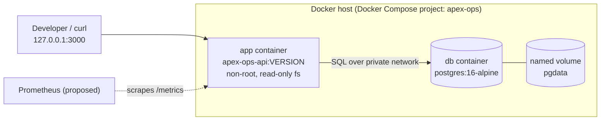
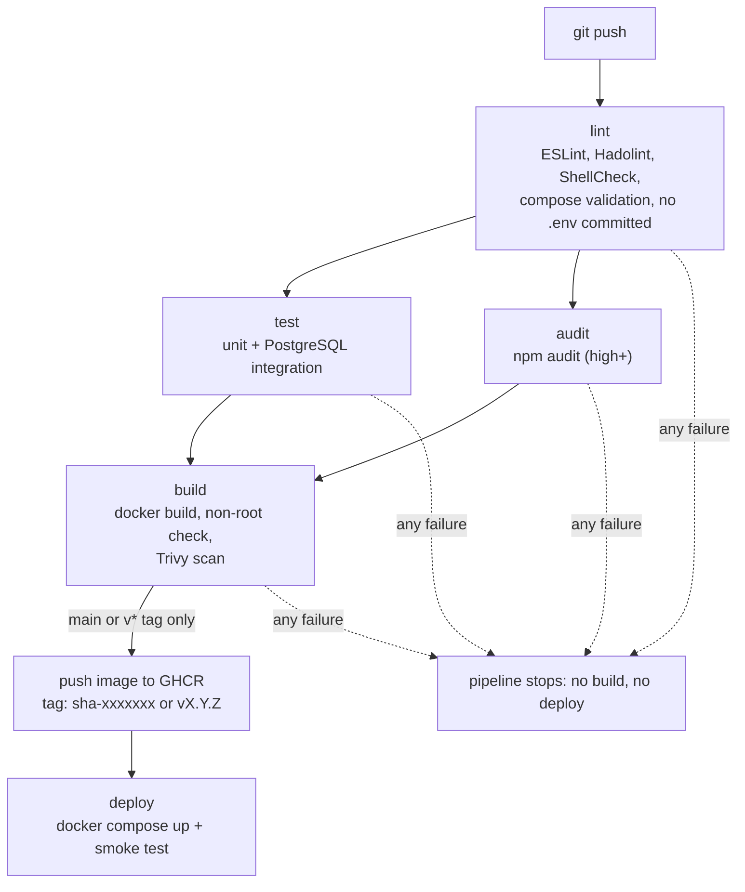
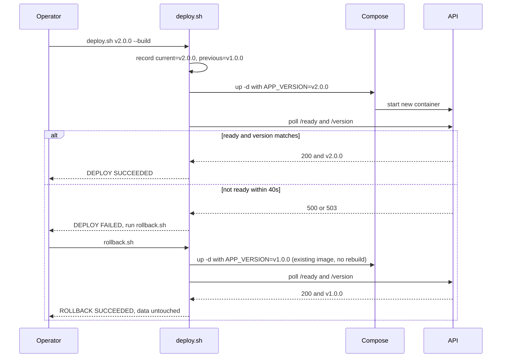

# Architecture and process diagrams

## 1. Runtime architecture (local deployment)

- Only the API port is published, and only on `127.0.0.1`. The database has no published port.
- The `db` container has a healthcheck (`pg_isready`). The `app` container starts only when the database is healthy (`depends_on: condition: service_healthy`).
- Data lives in the `pgdata` named volume, so it survives container restarts, redeploys and rollbacks.

## 2. Commit to release (process)

## 3. Release and rollback (process)

